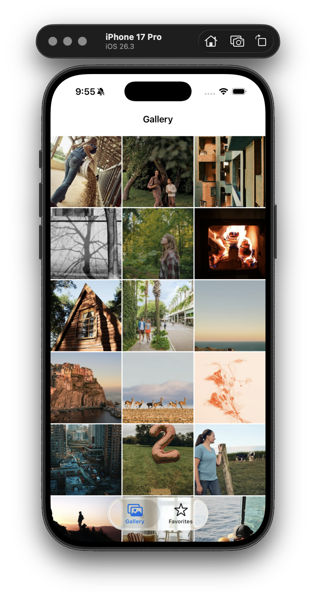
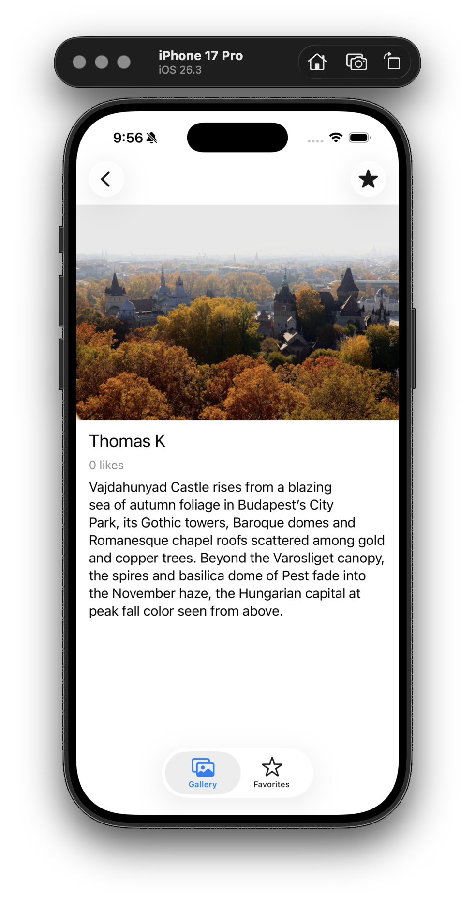
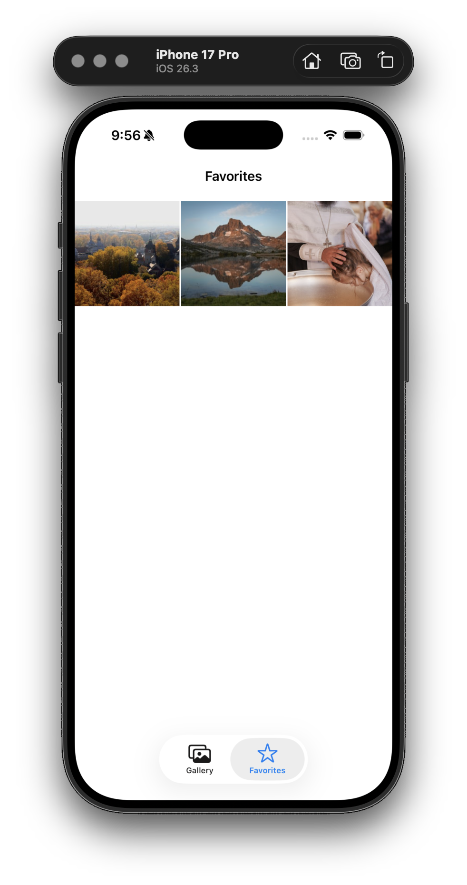

# Gallery App

iOS photo gallery built on the Unsplash API. Test assignment for an iOS internship.

## Features

- Photo grid with infinite scroll (pagination) and an in-memory image cache
- Photo detail screen: author, likes, description, full-size image
- Favorites: add and remove photos with a star, stored locally in Core Data
- Favorites tab that updates automatically and keeps data between app launches

## Screenshots

| Gallery | Detail | Favorites |
|---|---|---|
|  |  |  |

## Tech stack

- Swift, UIKit (programmatic UI), MVVM
- URLSession with async/await
- Core Data
- SwiftLint
- XCTest

## Architecture

- `Networking`: `PhotoService`, `ImageLoader` (with `NSCache`), `NetworkError`
- `ViewModels`: `GalleryViewModel`, `PhotoDetailViewModel`, `FavoritesViewModel`
- `Views`: `PhotoCell`, `PhotoDetailViewController`, `FavoritesViewController`
- `CoreData`: `CoreDataStack`, `FavoritesService`, `FavoritePhoto` model

## Requirements

- Xcode 26.3
- iOS 17.0 or later

## Setup

1. Clone the repository.
2. Get an access key: create an app at https://unsplash.com/developers and copy its Access Key.
3. Create your local secrets file from the template:

   ```
   cd GalleryApp/Config
   cp Secrets.example.xcconfig Secrets.xcconfig
   ```

4. Open `Secrets.xcconfig` and replace `YOUR_ACCESS_KEY_HERE` with your key:

   ```
   UNSPLASH_ACCESS_KEY = your_access_key
   ```

   `Secrets.xcconfig` is listed in `.gitignore`, so the key is never committed.
5. Open `GalleryApp/GalleryApp.xcodeproj` and run on a simulator.

If the key is missing, the app stops at launch with a message that explains how to set it.

Note: a demo Unsplash key allows about 50 requests per hour, so new pages may stop loading when the limit is reached. It resets every hour.

## Tests

Run with `Cmd + U` in Xcode. Covered: `FavoritesService` (in-memory Core Data) and `PhotoDetailViewModel`.